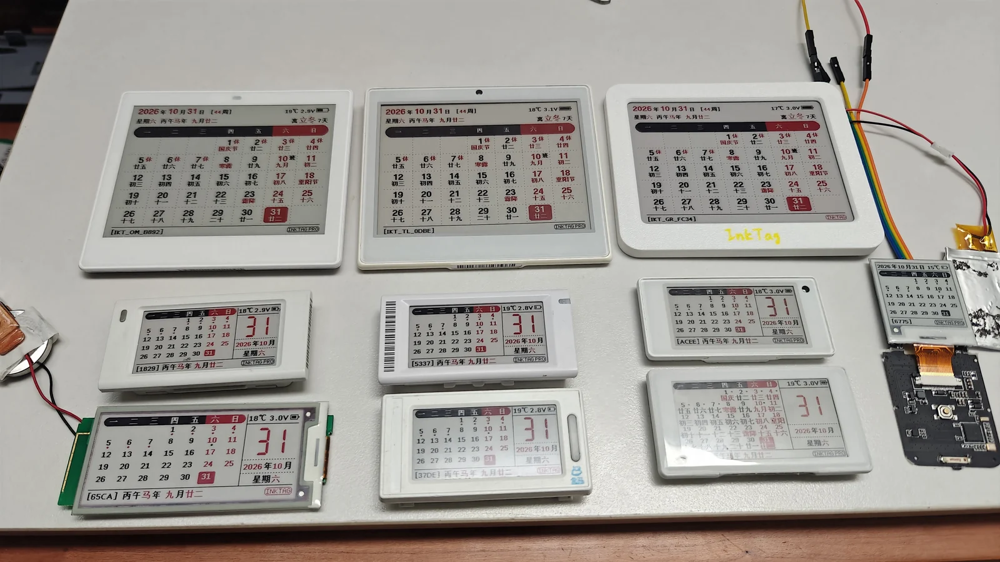

# InkTag

[中文](README.md) | English

InkTag is a cross-platform Bluetooth project for e-paper shelf labels, turning unused tags into desktop calendars, clocks, photo frames and information displays. InkTag provides custom firmware for Bluetooth controllers from Goodix, OnMicro, Telink, Nordic and Dialog. Using Web Bluetooth, you can change pictures, design pages and manage devices directly in a browser, or use the CLI for batch operations, weather stations and scheduled delivery.

Electronic paper reflects ambient light for a paper-like appearance. After an update, [the display needs no power to retain a static image](https://www.eink.com/tech/detail/Benefits), making it suitable for calendars, photos and reminders. With infrequent refreshes and long standby periods, even a coin-cell-powered tag can offer long battery life. Actual runtime depends on battery capacity, refresh frequency, Bluetooth use and the hardware.

[Illustrated manual](https://solar2ain.github.io/ink-tag-manual/) · [Project ideas](docs/en/projects.md) · [Open WebUI](https://solar2ain.github.io/ink-tag/) · [Use the local client](docs/en/webui.md#install-and-open) · [Changelog](CHANGELOG.md)



Some supported devices in use. See [supported devices](docs/en/supported-devices.md) and [tested panels](docs/en/tested-screens.md) for board markings and exact panel configurations.

## Quick start

After downloading or cloning this repository, you can open
`webui-standalone/InkTag-WebUI.html` directly in a compatible browser, without
starting a local server or deploying a website. Keep the accompanying `assets/`
and other resources. Bluetooth requires browser permission; Find location
queries still require the local client.

### 1. Prepare a device and browser

Use a device already running compatible InkTag firmware, with stable power and Bluetooth enabled on your computer or phone. Use Chrome or Edge on desktop. On iPhone/iPad, use [Bluefy](https://apps.apple.com/app/id1492822055). On Android, prefer Chrome. Open the site in that browser rather than an embedded WeChat/in-app window, and grant Bluetooth permission.

Stock devices need an appropriate first installation. Read [complete flashing](docs/en/flash.md) and identify the controller and board first. Choose the firmware, board configuration and tools for your exact device, install them, then connect to InkTag. Available files are listed in the [Release attachments](https://github.com/solar2ain/ink-tag/releases).

### 2. Open the WebUI and connect

Open [InkTag WebUI](https://solar2ain.github.io/ink-tag/), click Connect, and select your device in the browser's Bluetooth chooser. Factory names look like `IKT_TL_1234`; a name ending in `_OTA` identifies Recovery mode.

In Settings, check the controller, firmware version and screen configuration. Confirm the actual size, colours and orientation. If Bluetooth is unavailable or the device cannot be found, see [connection help](docs/en/faq.md) or try desktop Chrome/Edge.

### 3. Send your first picture

Open Images, import a photo, and adjust cropping, orientation and dithering. Check the preview, choose Send to device, select Display once, and confirm.

Wait for both transfer and screen refresh to finish. Flashing during a full refresh is normal; the screen may still be updating after transfer reaches 100%.

### 4. Try calendars, the canvas and slideshows

- Select the built-in calendar or clock in display settings.
- Open Create to edit a template or blank canvas with text, images and QR codes. You can send a template without first saving it as a page.
- Save pictures to image slots and enable a slideshow. When storage is full, select an existing slot to replace.

You can disconnect after completion. The device retains its picture, and supported built-in calendars, clocks and stored-image slideshows continue according to its settings.

See the [illustrated manual](https://solar2ain.github.io/ink-tag-manual/) and [getting started](docs/en/getting-started.md) for more detail.

## Free and Pro features

InkTag offers a free edition (Free) that already meets most everyday needs. Pro adds advanced and experimental features for users who enjoy tinkering and exploring. Availability depends on the capabilities of the connected device.

> [!NOTE]
> **Free firmware and donations**
>
> InkTag firmware is free to use. The project provides no purchase links. If you bought a device or related service from a merchant, contact that seller for purchase-related problems.
>
> A Pro activation code is provided after donating to support the project. Most Pro features are experimental and stability is not guaranteed. Please consider this carefully before activating Pro.

| Feature | 🆓 Free | ✨ Pro |
| --- | --- | --- |
| Images, built-in calendar, clock, device page and QR codes | Yes | Yes |
| Crop, rotate, dither, editable canvas and device preview | Yes | Yes |
| Stored images and slideshow | Normally 10 compact-screen or 4 larger-screen images | All available qualified storage |
| Screen, orientation, display and LED routing | Where supported | Same |
| Status LEDs and adapted buttons/buzzer | Where supported | Same |
| Bluetooth, diagnostics, OTA and Recovery | Yes | Yes |
| Passive NFC device link | With supported hardware | Yes |
| Host pages and custom delivery | Edit and preview | Advanced content admission follows device entitlement; scheduled delivery requires an online host |
| Switch pages or image slots with NFC phone commands | — | With supported hardware |
| Advanced screen control | — | Partial refresh on selected screens and E6 six-colour control, with compatible hardware, wiring and drivers |
| User fonts, BLE rename, optional device password | — | Where supported |
| Adjust/hide InkTag branding | — | Yes |
| Anti-loss tracker (Apple Find My network) | — | Experimental; register/control broadcasts online, query locations through a local service |
| NFC image transfer (planned) | — | Planned Pro feature; not yet available |
| Custom dynamic device layouts (planned) | — | Planned Pro feature; not yet available |

Compact means a visible long edge below 300 pixels. **Firmware-size limits make DA14585 and nRF52811 Free-only: Pro cannot be activated on these controllers. Their Free firmware has no image-slot count quota; the 10/4 limits do not apply, and the number of stored pictures is limited only by available storage.** See [image capacity](docs/en/devices.md#image-capacity) for storage sizes and estimates. Activation cannot add missing hardware. Partial-refresh clocks still perform a daily full refresh/background change and use more power than infrequent image updates. Offline E6 conversion is available without Pro.

See [Pro](docs/en/pro.md), [host pages](docs/en/host-pages.md), and [screens](docs/en/devices.md). Expanded partial refresh, custom device-executed layouts, NFC image transfer and disabling BLE advertising are future work, not promises of this version.

## Supported controllers

| Manufacturer | Controllers |
| --- | --- |
| Goodix | GR5331, GR5513, GR5515 |
| OnMicro | OM6626 |
| Telink | TLSR8359 (HS9118) |
| Nordic | nRF52832, nRF52811 |
| Renesas, formerly Dialog | DA14585 |

See [supported devices](docs/en/supported-devices.md) for board markings, product names and limitations, and [tested screens](docs/en/tested-screens.md) for panels, tested use and partial refresh. A supported controller does not make every board using it compatible.

## Choose how to use InkTag

### Online WebUI

The image page supports crop, canvas rotation, dithering, preview, display-only and stored-slot delivery. The canvas offers text, images, QR codes, weather and date-card templates. Settings expose only capabilities supported by the connected firmware.

Find is experimental anti-loss based on nearby participants in Apple's Find My network, not real-time GPS. Small labels can be carried with personal belongings. Register online, save an encrypted transfer backup and import it into a local client for location queries. You can also export all tags encrypted when moving computers; see [Find queries and migration](docs/en/find.md).

Use the online site without installation, or the local service for persistent data and Find. Runtime packages do not require Node.js. See [WebUI](docs/en/webui.md) and [online versus local](docs/en/github-pages.md).

### CLI for batch operations and automation

Install Python 3.11 or newer, download/clone this repository or extract the complete CLI ZIP, and enter the root containing both `cli/` and `webui/`. Use the unified installer:

**Windows:**

```powershell
powershell -NoProfile -ExecutionPolicy Bypass -File .\install_inktag.ps1
```

**macOS / Linux:**

```sh
sh install_inktag.sh
```

This installs the CLI into `cli/.venv` and automatically installs the **local Find query service dependencies** in a separate `find/runtime/.venv` under the per-user data directory. It then starts local WebUI and Find in the background (`webui start`); closing the terminal does not stop them. Setup prints copyable start, stop, status and log commands. New macOS installations store data and logs in `~/.inktag/`; an existing legacy directory is retained to preserve sessions and tags. System Python is unchanged; installation does not log into Apple, connect devices or clear existing data.

First setup requires internet access. Windows also requires full 7-Zip and downloads an Apple authentication image of about 292 MB on first setup. macOS uses native system authentication without that image. Location queries on Linux are not yet qualified.

To install without starting, run `powershell -NoProfile -ExecutionPolicy Bypass -File .\install_inktag.ps1 --prepare-only` on Windows or `sh install_inktag.sh --prepare-only` on macOS/Linux. After installation, choose either method below; command arguments are the same.

#### Method 1: run the client script without activation

Run from the repository or complete CLI package root. The script uses Python in `cli/.venv`; no global PATH entry is required.

**Windows PowerShell:**

```powershell
powershell -NoProfile -ExecutionPolicy Bypass -File .\cli\inktag.ps1 device scan
```

**macOS/Linux:**

```sh
bash cli/inktag.sh device scan
```

Replace `device scan` with another command, such as `device -n B892 info`, or use `--help`. If `cli/.venv` does not exist yet, run the installer first. These client scripts do not install Python itself.

#### Method 2: activate the Python environment and use `inktag-cli`

Prepare `cli/.venv` using the unified installer above, then activate it in your current terminal:

**Windows PowerShell:**

```powershell
. .\cli\.venv\Scripts\Activate.ps1
inktag-cli device scan
```

**macOS/Linux:**

```sh
source cli/.venv/bin/activate
inktag-cli device scan
```

Activate again in each new terminal; run `deactivate` to leave. If policy blocks the activation script, use Method 1 instead of changing system execution policy.

For a manually installed CLI-only environment, first install Python3.11+ and follow the [CLI guide](docs/en/cli.md) to create a virtual environment and install `cli/`. Use the unified installer when you need Find queries so its dependencies are prepared as well. Rerun the installer after updates.

The examples below use `inktag-cli` after activation. For Method 1, replace that prefix with the client script invocation:

```console
inktag-cli device --ble-name IKT_TL_1234 info
inktag-cli display --ble-name IKT_TL_1234 calendar
inktag-cli image --ble-name IKT_TL_1234 upload photo.jpg --slot next --name photo
inktag-cli device --ble-name IKT_TL_1234 slot list
inktag-cli device --ble-name IKT_TL_1234 display slideshow start --interval 5m
inktag-cli device --ble-name IKT_TL_1234 display slideshow stop
```

Replace the name and path with your device and image. Disconnect the same device from WebUI before using the CLI. See [CLI usage](docs/en/cli.md) for commands, credential caching and troubleshooting.

### Local service: enable Find device track recording

The repository and complete CLI ZIP include local WebUI and the Find query service; no separate server package is needed. Use the unified installer initially, then start with the same client commands:

**Windows:**

```powershell
powershell -NoProfile -ExecutionPolicy Bypass -File .\cli\inktag.ps1 webui start --repo . --enable-tls
```

**macOS/Linux:**

```sh
bash cli/inktag.sh webui start --repo . --enable-tls
```

With an activated Python environment, use:

```console
inktag-cli webui start --repo . --enable-tls
```

Open Find in the local WebUI, log in to your query account, register a tag or import its existing information, then choose “Start recording”. Keep the local service and network available so it can query periodically and save received location reports. A new location is not guaranteed for every query. See [WebUI usage](docs/en/webui.md) for installation/LAN access and [Find queries and migration](docs/en/find.md).

## Complete flashing and OTA

This version includes clients, guides, OTA and complete firmware for adapted boards, plus independent plaintext programmer tools under `firmware/<controller_board>/`.

Stock devices and wired recovery require an exact-controller, exact-board complete-flashing package. This clears MCU-side settings/data; heed the tool's scope warning, preserve identity/calibration and keep stock backups. Some boards retain a separate external image Flash as explicitly stated by the tool.

Prefer OTA for an existing InkTag installation. Connect in Settings → Firmware to see available firmware packages or select a local signed application. Wait for application attestation and reconnection; 100% transfer is not completion. After a failure, reconnect to confirm the current role/result, then select a matching package to retry if needed; never blindly replay an uncertain write.

Download firmware, programmer tools and clients from the actual [Release attachments](https://github.com/solar2ain/ink-tag/releases). Unlisted files are not available; never substitute a similar name or screen size. See [complete flashing](docs/en/flash.md), [OTA/Recovery](docs/en/ota.md) and [client updates](docs/en/updates.md).

## Help and privacy

E-paper has limited native colours and flashes during full updates. Low temperatures may slow refresh. For connection/display/login issues, see [FAQ](docs/en/faq.md). Report problems through [GitHub Issues](https://github.com/solar2ain/ink-tag/issues), including client version, controller, steps, error and redacted logs. Do not share passwords, activation codes, Find keys, sessions or location history; read [security/privacy](SECURITY.md).

## Acknowledgements

Thanks to [EPD-nRF5](https://github.com/tsl0922/EPD-nRF5), [ATC_TLSR_Paper](https://github.com/atc1441/ATC_TLSR_Paper), [epdoptimize](https://github.com/paperlesspaper/epdoptimize), [U8g2 for Adafruit GFX](https://github.com/olikraus/U8g2_for_Adafruit_GFX), WenQuanYi, [FindMy.py](https://github.com/malmeloo/FindMy.py), [os-findmy-e](https://github.com/sacca97/os-findmy-e), Leafer, React, Lucide, the controller tooling ecosystem, and everyone contributing hardware, tests and feedback. See [third-party notices](THIRD_PARTY_NOTICES.md).

## License

InkTag-owned firmware, compiled WebUI and CLI use [PolyForm Noncommercial 1.0.0](https://polyformproject.org/licenses/noncommercial/1.0.0) for purposes permitted by its noncommercial terms. Third-party works retain their original terms. See [licensing scope](LICENSING.md) for details and component information.

User documentation © InkTag contributors. All rights reserved.
