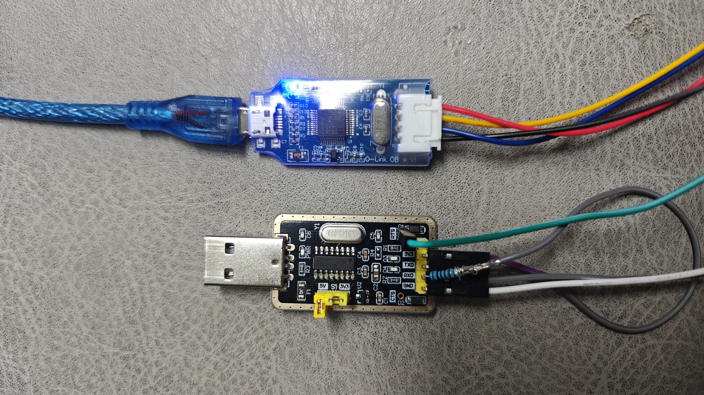

# Initial installation and complete flashing

Stock labels need wired flashing for the first InkTag installation. Existing InkTag devices should normally use [OTA](ota.md). Identify the [controller, board marking and panel](supported-devices.md) before choosing firmware/configuration; a product name alone is not enough.

## Directory layout

`firmware/` groups files by controller and board family, for example `gr551x_zkel`. Each board README maps product names, PCB markings and panel configurations.

```text
firmware/<controller_board>/
  README.md / README.en.md  devices, PCB markings and complete commands
  LICENSE / NOTICE...      applicable licenses and copyright notices
  ota/                    wireless update files
  full/                   first installation and wired recovery files
  tools/
    setup.ps1 / check.ps1  dependency setup and offline checks, where provided
    probe.ps1             board identification
    backup.ps1            backup, where supported
    flash.ps1             complete-flashing entry
    configs/              board and panel configurations
    internal/             entry routing and platform dependencies
      native/             unchanged original backend and relative paths
```

Run a board README's complete one-line command from that board directory in Windows PowerShell5.1. The common form is:

```powershell
powershell -NoProfile -ExecutionPolicy Bypass -File ".\tools\flash.ps1" -Firmware ".\full\matching-firmware-file" -Config ".\tools\configs\matching-board.toml" -RetryDetect
```

This illustrates the structure; use the actual filename/configuration already filled into each board README. TLSR also needs its real serial port. Tools require an explicit firmware argument and do not select or bind an old version.

The same `ota/` and `full/` bytes are also supplied as Release attachments, with matching size/SHA256. App-only OTA does not replace Recovery and cannot replace first complete flashing. Existing unavailable-writer/backend limits remain in the target README.

Dependencies remain within each original backend. Follow setup/check instructions; unsupported entry points are not fabricated. `releases/tool-manifests/` contains verification metadata, not another firmware family. The former top-level `flash/` and vendor placeholders are retired.

## Choose a programmer



- **Below: CH340 + a 1–2 kΩ resistor.** This simulates Telink SWS over a serial port. It is inexpensive but slower and less reliable; wiring, USB serial hardware and host timing matter. See the original author's [CH340/SWS wiring diagram](https://github.com/atc1441/ATC_TLSR_Paper/blob/main/USB_UART_Flashing_connection.jpg). Follow the resistor, SWS, ground and reset connections rather than treating it as an ordinary TX/RX connection. Never connect5V directly to label supply/signal pins.
- **Above: J-Link OB.** Used for SWD on the ARM controllers here. Follow the board's SWDIO/SWCLK/GND and required supply/reset wiring. It does not replace Telink SWS wiring.

The pictured boards each cost less than **RMB10** as a reference purchase price, excluding accessories. Search for “CH340 USB TTL” or “J-Link OB”; actual prices and specifications vary. These are examples of inexpensive boards, not a guarantee that every similarly named board is compatible.

## Software and drivers

The J-Link routes use **SEGGER J-Link Software and Documentation Pack7.88j, Windows x64**, including the USB driver. Select that archived version from [SEGGER downloads](https://www.segger.com/downloads/jlink/).7.88j is the PC software version, not the probe's printed hardware version. Keep its installation directory, such as `C:\Program Files\SEGGER\JLink_V788j`.

| Controller | Programmer | Required software/dependencies | Directory |
| --- | --- | --- | --- |
| GR5331, GR5513/GR5515 | J-Link OB / SWD | Windows x64; Python3.12 x64; J-Link7.88j; Goodix GProgrammer console2.0.3.0 with its original loaders/DLL | `firmware/gr5331_zkel`, `gr551x_zkel`, `gr551x_zkel_internal` |
| OM6626 | J-Link OB / SWD | Windows x64; Python3.12.0 x64; J-Link7.88j; OM6626 J-Link device-support files. Follow the directory's `DEPENDENCIES.txt` and version checks | `firmware/om6626_zkel` |
| TLSR8359 | CH340 / SWS | Python3.11+; CH340 driver; serial dependencies prepared by its `setup.ps1`. No J-Link needed | `firmware/tlsr8359_hsel` |
| nRF52811 | Current tools: J-Link / SWD | Windows x64; J-Link7.88j and USB driver. Portable Python/dependencies are included; no system Python needed | `firmware/nrf52811_aesl` |
| nRF52832 | Current tools: J-Link / SWD | Windows x64; J-Link7.88j and USB driver. Portable Python/dependencies included; check its README for actual writer availability | `firmware/nrf52832_priceetag` |
| DA14585 | J-Link OB / SWD | Windows x64; J-Link7.88j and USB driver. Portable Python/dependencies included; complete writing also needs the backend conditions in its README | `firmware/da14585_aesl` |

If the CH340 already appears as a serial port, do not reinstall a driver unnecessarily. Otherwise use WCH's [Windows](https://www.wch.cn/downloads/CH341SER_EXE.html) or [macOS](https://www.wch.cn/downloads/CH341SER_MAC_ZIP.html) driver. Follow actual pin markings, not wire colours in the photo.

### What about macOS?

- **Telink CH340/SWS serial simulation can be used on macOS**, with tools for the actual host/controller. The Windows PowerShell commands below are not macOS commands.
- **nRF flashing through DAPLink on macOS has been demonstrated, but is not yet integrated into the current distribution tools.** DAPLink is not CH340; nRF uses SWD, not Telink SWS.
- Other wired flashing workflows in this release use **Windows**. This is the current tool support boundary, not a claim that the hardware can never be programmed on another OS.

See [pvvx's macOS serial-tool information](https://github.com/pvvx/TlsrComSwireWriter) for host timing/platform background. External links explain construction/wiring/platforms; they do not replace InkTag's matching complete-firmware and retention/verification procedure with another project's generic erase commands.

## Download, connect and flash

1. Download the exact target's **complete firmware** from [Releases](https://github.com/solar2ain/ink-tag/releases). Plaintext tools are in `firmware/<controller_board>/` in the repository. Pass firmware explicitly; tools contain no firmware and an OTA package is not a complete image.
2. Open Windows PowerShell5.1 or newer in the chosen directory and read its bilingual README. It lists a complete copyable command for every device/board/configuration.
3. Install the software above, then follow the board README for its `tools/setup.ps1` or `tools/check.ps1`. Public entry points use the same layout; the native backend manages its own dependencies.
4. Use the board's actual wiring, stable power and common ground. Probe and preserve an available factory backup, then select the exact configuration, flash and verify readback.

For example, view help without a device from **`firmware/gr5331_zkel`**:

```powershell
powershell -NoProfile -ExecutionPolicy Bypass -File ".\tools\flash.ps1" -Help
```

Copy the actual flashing line from the selected directory's README. It supplies `-Firmware`, `-Config` and `-RetryDetect`; TLSR also needs the actual port, such as `-Port COM3`. RetryDetect retries initial detection only, never an erase/write or unknown result.

Complete flashing clears MCU-side settings/data. Necessary factory identity, BLE address, calibration and valid same-device Pro are retained according to each tool's instructions. Separate external picture Flash without an erase backend is retained. Some portable writing entries are not yet available: an offline preflight is not proof that writing is enabled.

## TLSR: offline bin generation and direct writing

Download the complete checkout and retain `firmware/tlsr8359_hsel/tools/`, including `internal/`; do not move a single script into the root. Run its `setup.ps1` to install Python dependencies. InkTag CLI is not required.

Run these commands from the **ink-tag checkout root**. They use the published **0.2.1** package and `HSEL5_01_54M_02` preset. Generation is offline. Each invocation assigns a new Static Random MAC and produces a **512-KiB (524288-byte)** bin plus companion JSON for one device. Existing outputs are refused; do not reuse this explicit-address bin on multiple devices.

```powershell
powershell -NoProfile -ExecutionPolicy Bypass -File ".\firmware\tlsr8359_hsel\tools\generate-bin.ps1" -Firmware ".\firmware\tlsr8359_hsel\full\InkTag-tlsr8359_hsel-full-v0.2.1.0-306bd2ed0f10.zip" -Config ".\firmware\tlsr8359_hsel\tools\configs\HSEL5_01_54M_02.toml" -Mac ("C2"+[guid]::NewGuid().ToString("N").Substring(0,10)) -AddressType StaticRandom -Output ".\HSEL5_01_54M_02-0.2.1.bin"
```

0.2.1 requires an explicit MAC. Replace the `-Mac` expression with a fixed address if needed. Explicit addresses default to Public; static-random addresses require `-AddressType StaticRandom` and two high bits set in the first byte. Omitting MAC is allowed only when both packaged App and Recovery advertise automatic provisioning; older packages are refused before hardware access. Updating tools does not replace released App/Recovery bytes or signatures.

**This bin initializes Free**, replacing lower-512-KiB factory data, calibration, Pro, passwords, settings, fonts and images; calibration uses SDK defaults. For same-device identity/calibration and valid Pro preservation, retain the original `flash.ps1 -Firmware ... -Config ... -Port ...` workflow and its default readback.

In BDT, load the entire bin at **Flash address `0x00000`**, then verify. Erase/write only `0x00000–0x7FFFF`. On qualified 1-MiB boards, upper image slots remain untouched; avoid chip erase. Existing valid upper images can remain occupied. Select the configuration matching the actual hardware.

CH340/SWS can also write the generated bin. Replace `COM13` with the actual port. This 48-MHz example uses the protected stopped-24-MHz programming link and complete readback, then resets into the firmware's normal startup frequency:

```powershell
powershell -NoProfile -ExecutionPolicy Bypass -File ".\firmware\tlsr8359_hsel\tools\flash-bin.ps1" -Bin ".\HSEL5_01_54M_02-0.2.1.bin" -Port COM13 -PrepareClock24 -Verify
```

`flash-bin.ps1` accepts the bin alone: no ZIP, configuration or companion JSON. It validates signatures/records locally and writes the supplied lower-512-KiB bytes unchanged. Normal mode does not read old MAC, UID, Factory or Settings and preserves no old data. Optional `-PrepareClock24` repair reads the target UID/JEDEC to validate the link, without reading old firmware. Confirmation defaults to y/N; `-Yes` skips the prompt.

**Without `-Verify`, the default writes without readback**, reporting `BIN-WRITTEN-NOT-VERIFIED`; a complete match reports `BIN-READBACK-MATCHED`. Baud defaults to the bin board registration (460800 here); divider and Flash checks remain. `-RetryDetect` retries initial detection only. Short echoes, decode failures or serial errors during programming stop immediately without automatic rewrite or reset/run. `-DryRun` validates local input without hardware. Offline checks do not qualify additional boards, displays, RF operation or BDT hardware.

## If startup or connection fails

Check the battery, power, wiring, actual controller and tool versions. Stop on unknown hardware, abnormal supply or readback failure; retain errors/backups rather than repeatedly erasing. If InkTag Recovery remains reachable, use a matching trusted OTA package.

Ordinary WebUI/CLI use does not require a firmware SDK, Keil or MCU compiler. See [devices/panels](devices.md), [OTA/Recovery](ota.md) and [getting started](getting-started.md).
