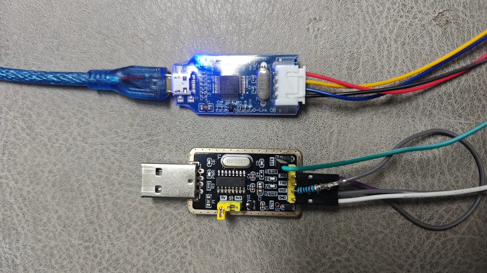

# First installation and complete flashing

Use wired flashing to install InkTag on a factory tag. Use [OTA](ota.md) for routine updates to compatible installed firmware. Check the [controller, PCB marking, and panel](supported-devices.md) first.

## Flash with BAT in 0.2.2

1. Open the target directory in [release/firmware](../../release/firmware/). Keep the relative paths of the tools, `full/`, and configurations. Use a Full package for first installation.
2. Set up the programmer and software listed below. On Windows, double-click `flash.bat` for English or `flash-zh.bat` for Chinese. For command-line use, open the target directory and copy the command for your board from its installation guide.
3. The guide uses a single suitable Full automatically, lists multiple matches, or opens a file picker if it finds none. Select the board and panel, then review and confirm the operation.
4. After confirmation, detection waits for the target by default. The direct `flash-bin.bat` and `flash-hex.bat` entries also retry initial detection by default. Follow the prompt to cancel. Keep any write or readback error and check device state before retrying.

| Target | English guide | Installation instructions |
| --- | --- | --- |
| GR5331 | [flash.bat](../../release/firmware/gr5331_zkel/tools/flash.bat) | [Board presets and commands](../../release/firmware/gr5331_zkel/INSTALL.en.md) |
| GR5513/GR5515 standard | [flash.bat](../../release/firmware/gr551x_zkel/tools/flash.bat) | [Board presets and commands](../../release/firmware/gr551x_zkel/INSTALL.en.md) |
| GR5513 Internal | [flash.bat](../../release/firmware/gr551x_zkel_internal/tools/flash.bat) | [Board presets and commands](../../release/firmware/gr551x_zkel_internal/INSTALL.en.md) |
| OM6626 ZKEL | [flash.bat](../../tools/platforms/onmicro/om6626/programmer/payload/tools/flash.bat) | [Board presets and commands](../../tools/platforms/onmicro/om6626/programmer/INSTALL.en.md) |
| TLSR8359 HSEL | [flash.bat](../../release/firmware/tlsr8359_hsel/firmware/ports/telink/tlsr8359/tools/flash.bat) | [Board presets and commands](../../release/firmware/tlsr8359_hsel/INSTALL.en.md) |
| nRF52811 AESL | [flash.bat](../../release/firmware/nrf52811_aesl/tools/flash.bat) | [Board presets and commands](../../release/firmware/nrf52811_aesl/INSTALL.en.md) |
| nRF52832 PriceETag | [flash.bat](../../release/firmware/nrf52832_priceetag/tools/flash.bat) | [Board presets and commands](../../release/firmware/nrf52832_priceetag/INSTALL.en.md) |
| DA14585 AESL | [flash.bat](../../release/firmware/da14585_aesl/tools/programmer/flash.bat) | [Board presets and commands](../../release/firmware/da14585_aesl/INSTALL.en.md) |

## Required software

The recommended BAT entries for GR, OM, nRF52811 and nRF52832 use the built-in **Windows PowerShell 5.1 and .NET** and work without Python. For J-Link targets, install **SEGGER J-Link Software and Documentation Pack 7.88j (Windows x64)** with its USB driver. 7.88j is the software version. [SEGGER downloads](https://www.segger.com/downloads/jlink/)

| Controller | Connection | Additional requirements |
| --- | --- | --- |
| GR5331, GR5513/GR5515 | J-Link / SWD | [Goodix GProgrammer console 2.0.3.0](https://www.goodix.com/en/software_tool/gprogrammer_ble) with its loader, DLL, and configuration files |
| OM6626 | J-Link / SWD | The repository includes the OM device-support files |
| nRF52811, nRF52832 | J-Link / SWD | The J-Link software and driver above |
| TLSR8359 | CH340 / SWS | Python 3.11+ and the CH340 driver. Run `setup.bat` to install the serial-tool dependencies |
| DA14585 | J-Link / SWD | Python 3.12+ with `python` on PATH, plus the separately obtained licensed SRAM helper specified in the tools guide |

For TLSR, run this command from `release/firmware/tlsr8359_hsel/`, or double-click [setup.bat](../../release/firmware/tlsr8359_hsel/firmware/ports/telink/tlsr8359/tools/setup.bat). With arguments, the BAT returns the exit code:

```powershell
.\firmware\ports\telink\tlsr8359\tools\setup.bat -Python python
```

## Choose a programmer



- **Top, J-Link OB.** Use SWD for ARM controllers. Follow the board guide for SWDIO, SWCLK, ground, and power or reset as needed.
- **Bottom, CH340 with a 1–2 kΩ resistor.** This serial adapter emulates Telink SWS. Wiring and USB timing affect speed and reliability. Follow the [wiring diagram](https://github.com/atc1441/ATC_TLSR_Paper/blob/main/USB_UART_Flashing_connection.jpg) and match the board's signal levels.

Both pictured adapters were purchased for under RMB 10 each, excluding accessories. If the system cannot find the CH340 serial port, install the [Windows driver](https://www.wch.cn/downloads/CH341SER_EXE.html) or [macOS driver](https://www.wch.cn/downloads/CH341SER_MAC_ZIP.html) from WCH. Telink's CH340/SWS approach also works on macOS. See the [macOS serial tool notes](https://github.com/pvvx/TlsrComSwireWriter). nRF DAPLink/SWD flashing has also been demonstrated on macOS. The current BAT workflow runs on Windows.

## Use prebuilt BIN or HEX images

Choose the matching PCB and screen configuration in `programmer/` and follow its address table. BIN requires an explicit start address and address space. Intel HEX carries the addresses in its records.

- GR, TLSR and DA14585 provide `flash-bin.bat`. GR and DA use the matching initialization materials. TLSR uses the requested BIN and its companion JSON. When using BDT on TLSR, follow the board's address table.
- Both nRF targets provide `flash-hex.bat`. The nRF52811 settings and GUI resources have separate external flash addresses.
- OM uses `flash.bat` with Full and a matching configuration. The segment files can be checked against the address table.

Complete flashing and initialization may clear device settings and data. Follow the board guide to back up the data you need and check the readback result.

## Flash with a graphical tool

Guides for graphical flashing tools are in progress. If you have a tested procedure, please share the tool and version, PCB marking, firmware files, and flash addresses you used. [Open an issue](https://github.com/solar2ain/ink-tag/issues) · [Submit a guide](https://github.com/solar2ain/ink-tag/pulls)

[Build firmware](../build-firmware.en.md) · [Supported devices](supported-devices.md) · [OTA and Recovery](ota.md)
