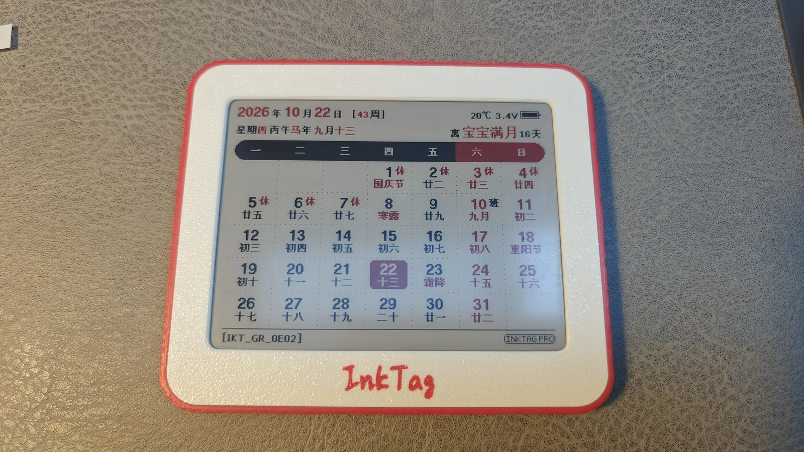
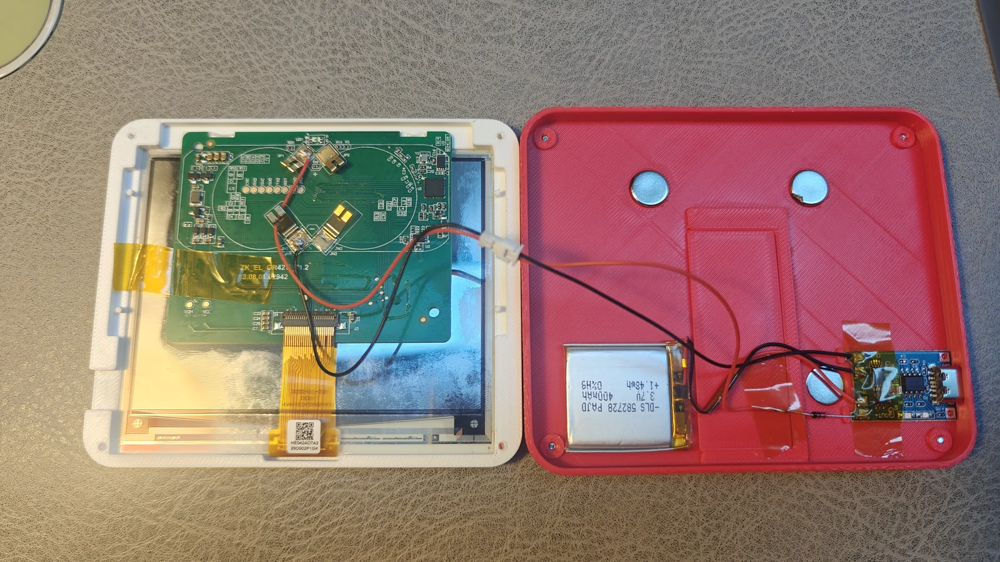
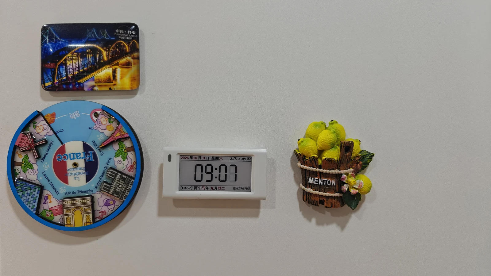
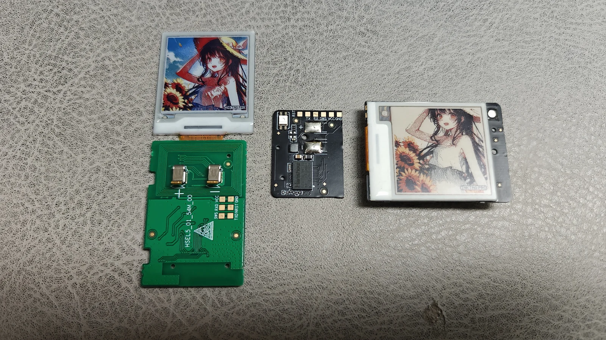
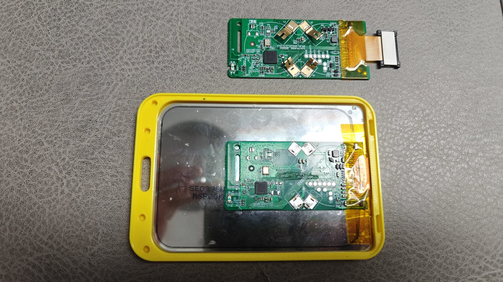

# Things to make with InkTag

Turn a shelf label into a calendar, small clock, personal anti-loss tag or reusable electronic photo. These are real builds; choose a board and panel that match what you have.

| Project | Main parts | Features |
| --- | --- | --- |
| 4.2-inch calendar or photo album | 4.2-inch label, printed enclosure | Free: built-in calendar, photos and stored-image slideshow |
| Magnetic mini clock | ZKC21V with a supported panel | Free for an ordinary clock; Pro and a compatible panel for partial refresh |
| PhotoTag-style tag | Nebular/Stellar 154Q, or an early replaceable-panel Stellar 154R + E6 | Pro for Find and E6 control; experimental |
| Instant-photo-style frame | Huawei 3.98-inch four-colour panel + ZKC21V/ZKC21B | Free can send static photos |

## Project 1: a 4.2-inch calendar or photo album

Fit a new enclosure and stand the label on a desk or attach it magnetically. The built-in calendar changes date automatically. For a photo album, save pictures into slots and enable a slideshow, or keep a single favourite photo.

### What you need

- A supported 4.2-inch label; 400×300 is a common panel size.
- An enclosure matching the board/panel, and magnets if desired.
- A compatible battery, charger and supply circuit for a rechargeable conversion.

Use the [slim 4.2-inch enclosure model on MakerWorld](https://makerworld.com.cn/zh/models/3018140-4-2cun-mo-shui-ping-jie-qian-chao-bo-wai-ke-tp4056#profileId-3546023). It offers a 9mm version with a stand and a 7mm version without, with space for a TP4056 board. Check actual board, battery and cable clearance. The model page also has [front](../assets/projects/calendar-front.webp) and [back](../assets/projects/calendar-back.webp) references.

### Set it up

1. Identify the controller and board in [supported devices](supported-devices.md), then install matching firmware.
2. Connect the [WebUI](https://solar2ain.github.io/ink-tag/) and select the actual panel/orientation.
3. Set the time and choose the built-in calendar; add a countdown if desired. For an album, upload photos into slots and choose a slideshow interval.
4. Wait for refresh, disconnect and fit the enclosure. Built-in calendars and device slot slideshows do not require an always-on computer.

**Do not recharge the original disposable coin cells.** Check the board's permitted supply voltage when converting to a rechargeable battery. Space for a charger does not mean every charger/battery can connect directly to every board.

## Project 2: a ZKC21V magnetic mini clock

Use a ZKC21V as a small clock for the fridge, desk or bedside.

Set the time in WebUI and choose the built-in clock. The pictured build uses partial refresh: it requires Pro and a panel configuration that actually supports it. Different ZKC21V boards/panels do not necessarily share that ability. An ordinary clock is available in Free.

Partial-refresh clocks still perform a daily full refresh/background change, and frequent refresh uses more power. See [tested panels](tested-screens.md).

## Project 3: a PhotoTag-style personal anti-loss tag

Show a photo, name or contact information and enable experimental Apple Find My network broadcasts.

### Choose a device

- **Nebular-154Q-N or Stellar-154Q-N:** a four-colour black/white/red/yellow photo tag. Some labels include Pro in the product name; still identify the actual board.
- **Early replaceable-panel Stellar-154R-N:** fit an **E6 1.54-inch six-colour panel** for a six-colour PhotoTag. The later fixed-panel revision cannot use this conversion; check supported configurations such as `HSEL5_01_54M_00`.
- **Nebular-213R-N:** its small board can be used without the display. Connect a suitable battery and fit it inside a bag, enclosure or other personal item as an anti-loss tag.

E6 control needs Pro. On ordinary label boards, follow the [panel instructions](tested-screens.md#e6-six-colour-screens) to insulate cable pin16 and leave it floating; otherwise the panel may heat up and draw excessive power. Disconnect power before work and do not apply this wiring to different cables.

### Set it up

1. Match firmware, configuration and panel using [supported devices](supported-devices.md) and [tested panels](tested-screens.md). Check cable/pin compatibility before a panel swap.
2. Import a photo, preview and adjust dithering, or add a name, phone number or QR code on the canvas, then send it.
3. Activate Pro on a supported board and enable broadcasts on Find.
4. Save the device information, import it into a local client and enable recording as described in [Find and tag migration](find.md). The hosted and standalone versions do not include the query backend.

Nearby participating Apple Find My devices relay reports. **This is not real-time GPS and updates are not guaranteed.** It is experimental, not Apple certification or full PhotoTag compatibility, and is intended to help find personal belongings.

## Project 4: an instant-photo-style electronic frame

Use a **Huawei 3.98-inch 768×552 four-colour panel + ZKC21V or ZKC21B board**. Remove the original display and solder/adapt the connections to make a reusable electronic photo.

### Parts and assembly

- The black/white/red/yellow panel, matching cable/adapter, suitable power and a frame.
- A ZKC21V or ZKC21B board. ZKC21V has different MCU variants: identify the actual controller and marking.
- The pictured ZKC21V was trimmed to fit. Disconnect power, identify the antenna/traces/pads and remove cutting debris. Different revisions cannot be cut to dimensions inferred from this photo.

### Set it up

1. Select the actual Huawei A0/A1 configuration and orientation in WebUI; do not interchange them.
2. Import and crop a photo, or use a static canvas with a white border, date and caption.
3. Preview using the four-colour device palette. Other colours and gradients are represented by dithering.
4. Send once to check orientation, edges and the complete picture, then save it into a slot or configure a slideshow.
5. Wait for refresh, disconnect and fit the frame. The panel has no backlight and needs ambient light.

Build photos were supplied by the project author. Model reference photos are from the original model page by [didi (@solar2ain)](https://makerworld.com.cn/zh/@solar2ain). Example content shown on the screens retains its authors' rights.

---

[Getting started](getting-started.md) · [Flashing and tools](flash.md) · [Project home](../../README.en.md)
