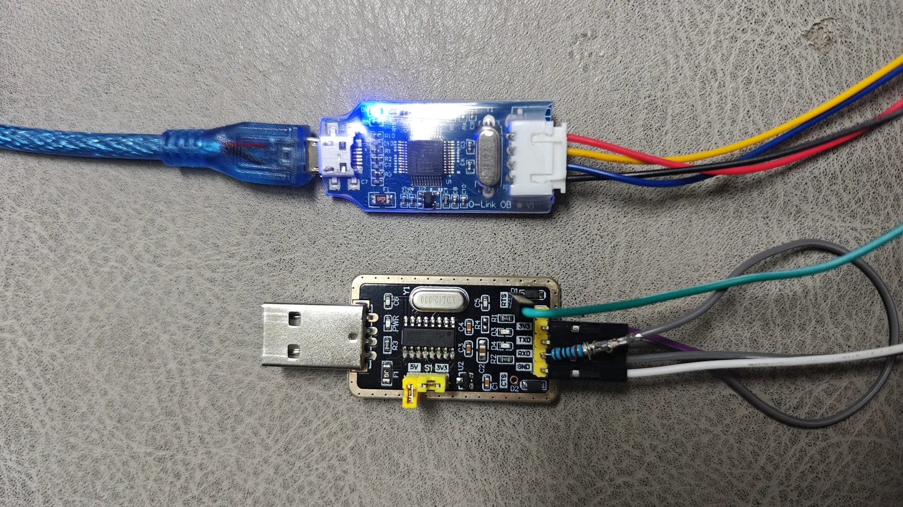

# 首次安装与完整烧录

原厂价签首次安装 InkTag 使用有线烧录。已安装兼容 InkTag 固件的设备，日常升级见 [OTA](ota.md)。先核对[主控、主板丝印和屏幕](supported-devices.md)。

## 0.2.2 用 BAT 烧录

1. 打开 [release/firmware](../../release/firmware/) 中对应的目标目录，保留工具、`full/` 和配置的相对路径。首次安装使用 Full。
2. 按下方准备好烧录器和软件。Windows 用户双击 `flash-zh.bat` 使用中文向导，`flash.bat` 使用英文。命令行用户在目标目录复制安装说明里的对应版型命令。
3. 向导找到唯一合用的 Full 会自动采用，多份时列出选项，找不到时打开文件选择框。选择主板和屏幕配置，核对烧录范围后再确认。
4. 确认后默认持续检测，直接烧录的 `flash-bin.bat`、`flash-hex.bat` 也默认轮询。按窗口提示取消。轮询只用于初始探测。写入或回读失败后，先保留提示并核对目标状态。

| 目标 | 中文向导 | 安装说明 |
| --- | --- | --- |
| GR5331 | [flash-zh.bat](../../release/firmware/gr5331_zkel/tools/flash-zh.bat) | [版型与一行命令](../../release/firmware/gr5331_zkel/INSTALL.md) |
| GR5513／GR5515 标准版 | [flash-zh.bat](../../release/firmware/gr551x_zkel/tools/flash-zh.bat) | [版型与一行命令](../../release/firmware/gr551x_zkel/INSTALL.md) |
| GR5513 Internal | [flash-zh.bat](../../release/firmware/gr551x_zkel_internal/tools/flash-zh.bat) | [版型与一行命令](../../release/firmware/gr551x_zkel_internal/INSTALL.md) |
| OM6626 ZKEL | [flash-zh.bat](../../tools/platforms/onmicro/om6626/programmer/payload/tools/flash-zh.bat) | [版型与一行命令](../../tools/platforms/onmicro/om6626/programmer/INSTALL.md) |
| TLSR8359 HSEL | [flash-zh.bat](../../release/firmware/tlsr8359_hsel/firmware/ports/telink/tlsr8359/tools/flash-zh.bat) | [版型与一行命令](../../release/firmware/tlsr8359_hsel/INSTALL.md) |
| nRF52811 AESL | [flash-zh.bat](../../release/firmware/nrf52811_aesl/tools/flash-zh.bat) | [版型与一行命令](../../release/firmware/nrf52811_aesl/INSTALL.md) |
| nRF52832 PriceETag | [flash-zh.bat](../../release/firmware/nrf52832_priceetag/tools/flash-zh.bat) | [版型与一行命令](../../release/firmware/nrf52832_priceetag/INSTALL.md) |
| DA14585 AESL | [flash-zh.bat](../../release/firmware/da14585_aesl/tools/programmer/flash-zh.bat) | [版型与一行命令](../../release/firmware/da14585_aesl/INSTALL.md) |

## 烧录前准备

GR、OM、nRF52811 和 nRF52832 的推荐 BAT 使用 Windows 自带的 **PowerShell 5.1／.NET**，无需安装 Python。使用 J-Link 的平台统一安装 **SEGGER J-Link Software and Documentation Pack 7.88j（Windows x64）** 及 USB 驱动。7.88j 是软件版本。 [SEGGER 下载页](https://www.segger.com/downloads/jlink/)

| 主控 | 接口 | 还需准备 |
| --- | --- | --- |
| GR5331、GR5513／GR5515 | J-Link／SWD | [Goodix GProgrammer console 2.0.3.0](https://www.goodix.com/en/software_tool/gprogrammer_ble)，保留随附的 loader、DLL 和配置 |
| OM6626 | J-Link／SWD | 已随仓库提供 OM 设备支持文件 |
| nRF52811、nRF52832 | J-Link／SWD | 上述 J-Link 软件和驱动即可 |
| TLSR8359 | CH340／SWS | Python 3.11+ 和 CH340 驱动，首次运行 `setup.bat` 安装串口工具依赖 |
| DA14585 | J-Link／SWD | Python 3.12+，让 `python` 命令可用，并单独准备工具说明指定的已许可 SRAM helper |

TLSR 在 `release/firmware/tlsr8359_hsel/` 中执行以下命令，或双击 [setup.bat](../../release/firmware/tlsr8359_hsel/firmware/ports/telink/tlsr8359/tools/setup.bat)。命令行带参数调用会返回退出码：

```powershell
.\firmware\ports\telink\tlsr8359\tools\setup.bat -Python python
```

## 选择烧录器



- **上侧 J-Link OB** 用于 ARM 主控的 SWD 烧录。按主板说明接 SWDIO、SWCLK、GND 及所需电源或复位线。
- **下侧 CH340 + 1–2 kΩ 电阻** 用串口模拟 Telink SWS。速度和稳定性取决于接线和 USB 时序。按[接线图](https://github.com/atc1441/ATC_TLSR_Paper/blob/main/USB_UART_Flashing_connection.jpg)连接，使用与主板匹配的信号电平。

两种小板的参考购入价均不到人民币 10 元，不含配件。系统未识别 CH340 串口时，安装沁恒的 [Windows 驱动](https://www.wch.cn/downloads/CH341SER_EXE.html)或 [macOS 驱动](https://www.wch.cn/downloads/CH341SER_MAC_ZIP.html)。Telink 的 CH340／SWS 方案可在 macOS 使用，参考 [macOS 串口工具说明](https://github.com/pvvx/TlsrComSwireWriter)。nRF 的 DAPLink／SWD 曾在 macOS 验证可行，当前 BAT 流程使用 Windows。

## 使用预转换的 BIN／HEX

从 `programmer/` 选择匹配主板和屏幕的材料，按地址表操作。BIN 需要对应的写入地址及地址空间，Intel HEX 自带地址记录。

- GR、TLSR 和 DA14585 提供 `flash-bin.bat`。GR 和 DA 使用配套初始化物料，TLSR 使用对应 BIN 及同名 JSON。用 BDT 烧 TLSR 时按该板型地址表操作。
- 两款 nRF 提供 `flash-hex.bat`。nRF52811 的外置设置和 GUI 有单独的写入地址。
- OM 使用 `flash.bat` 加 Full 和匹配的配置，分段文件可对照地址表。

完整烧录及初始化可能清理设置和数据。先按板型说明备份，烧录完成后核对回读结果。

## 使用图形界面烧录工具

各平台的图形界面烧录教程待补充。欢迎分享你实测过的操作步骤，并注明烧录软件和版本、主板丝印、使用的文件及写入地址。 [提交 Issue](https://github.com/solar2ain/ink-tag/issues) · [提交教程 PR](https://github.com/solar2ain/ink-tag/pulls)

[构建固件](../build-firmware.md) · [已适配设备](supported-devices.md) · [OTA 与 Recovery](ota.md)
