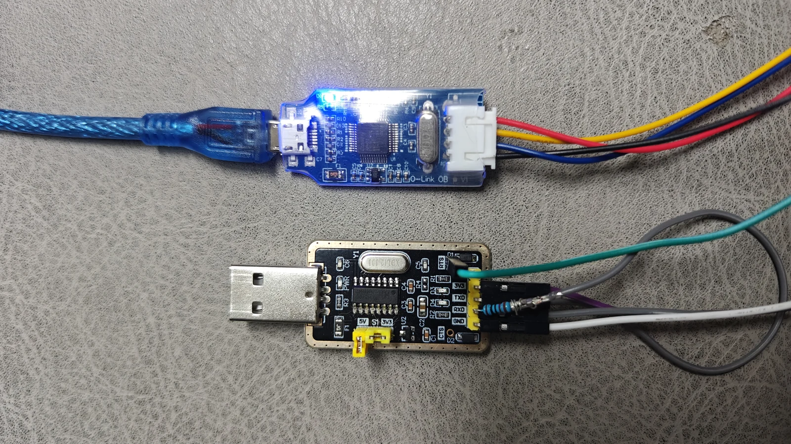

# 首次安装与完整烧录

原厂价签首次安装 InkTag 需要有线烧录；已经运行 InkTag 的设备，日常升级优先使用 [OTA](ota.md)。先确认[主控、主板丝印和屏幕](supported-devices.md)，再选择对应固件与配置，不要只凭价签的产品名。

## 目录结构与文件用途

`firmware/` 只按主控和主板家族分目录，例如 `gr551x_zkel`；产品型号、丝印与屏幕对应关系写在各目录的 README。

```text
firmware/<主控_主板>/
  README.md / README.en.md  设备、丝印、配置和一行烧录命令
  LICENSE / NOTICE...      适用的许可及版权声明
  ota/                    无线更新文件
  full/                   首次安装及有线恢复文件
  tools/
    setup.ps1 / check.ps1  安装依赖、离线检查（按平台提供）
    probe.ps1             识别主板
    backup.ps1            备份（支持的平台提供）
    flash.ps1             完整烧录入口
    configs/              可选择的主板与屏幕配置
    internal/             入口转发和平台依赖，通常不用手动操作
      native/             原平台后端，原文件及相对目录保留
```

所有 Windows 示例使用 PowerShell5.1 可执行的一行命令，先进入具体主板目录：

```powershell
powershell -NoProfile -ExecutionPolicy Bypass -File ".\tools\flash.ps1" -Firmware ".\full\对应完整固件文件" -Config ".\tools\configs\对应主板配置.toml" -RetryDetect
```

这是一行命令的结构说明；请复制该主板 README 中填好真实文件名和配置的完整命令。TLSR 还需要实际串口参数。工具仍显式接收固件，不自动挑选或绑定某个旧版本。

`ota/` 与 `full/` 中的文件也提供为 GitHub Releases 附件，清单中的大小与 SHA256 相同。App OTA 不会替换 Recovery；不要把 OTA 当作首次完整烧录文件。平台尚缺写入后端的限制仍以对应 README 为准。

烧录依赖位于平台后端目录，按其 setup/check 提示准备；没有需要的入口时不提供伪按钮或空脚本。维护校验清单保存在 `releases/tool-manifests/`，不是额外固件族。旧 `flash/`、厂商分类占位目录已停用。

## 选择烧录器



- **下侧：CH340 + 1–2 kΩ 电阻。** 用串口模拟 Telink 的 SWS 烧录，成本低，但速度和稳定性较差，接线、USB 串口和系统时序都会影响结果。制作与连接方法参考原作者的 [CH340／SWS 接线图](https://github.com/atc1441/ATC_TLSR_Paper/blob/main/USB_UART_Flashing_connection.jpg)。按图连接电阻、SWS、共地和所需复位线，不能当成普通 TX/RX 串口直连；不要把 5V 直接接到价签的电源或信号脚。
- **上侧：J-Link OB。** 用于本项目 ARM 主控的 SWD 烧录，按主板说明连接 SWDIO、SWCLK、GND 及必要的电源／复位。它不能代替 TLSR 的 SWS 接线。

图示两种小板的参考购入价均不到 **人民币 10 元**，不含其他配件；可自行搜索“CH340 USB 转 TTL”“J-Link OB”，以实际商家价格和规格为准。图中是低价小板示意，不代表任意同名板都具有相同兼容性。

## 安装软件与驱动

J-Link 路径统一使用 **SEGGER J-Link Software and Documentation Pack 7.88j（Windows x64）**，包含 USB 驱动。到 [SEGGER 官方下载页](https://www.segger.com/downloads/jlink/)选择对应历史版本；这里的 7.88j 是电脑软件版本，不是小板上标注的硬件版本。保留安装目录，例如 `C:\Program Files\SEGGER\JLink_V788j`。

| 主控 | 烧录方式 | 需要准备的软件／依赖 | 对应目录 |
| --- | --- | --- | --- |
| GR5331、GR5513／GR5515 | J-Link OB／SWD | Windows x64；Python 3.12 x64；J-Link 7.88j；Goodix GProgrammer console 2.0.3.0，保留原配 loader、DLL | `firmware/gr5331_zkel`、`gr551x_zkel`、`gr551x_zkel_internal` |
| OM6626 | J-Link OB／SWD | Windows x64；Python 3.12.0 x64；J-Link 7.88j；OM6626 的 J-Link 芯片支持文件。按目录内 `DEPENDENCIES.txt` 安装，包内脚本检查其版本 | `firmware/om6626_zkel` |
| TLSR8359 | CH340／SWS | Python 3.11+；CH340 驱动；工具 `setup.ps1` 所需的串口依赖，无需 J-Link | `firmware/tlsr8359_hsel` |
| nRF52811 | 当前发行工具使用 J-Link／SWD | Windows x64；J-Link 7.88j 和 USB 驱动。工具目录已提供便携 Python／依赖，无需另外安装系统 Python | `firmware/nrf52811_aesl` |
| nRF52832 | 当前发行工具使用 J-Link／SWD | Windows x64；J-Link 7.88j 和 USB 驱动。工具目录已提供便携 Python／依赖；实际写入是否开放见该目录 README | `firmware/nrf52832_priceetag` |
| DA14585 | J-Link OB／SWD | Windows x64；J-Link 7.88j 和 USB 驱动。工具目录已提供便携 Python／依赖；完整写入还受 README 所列后端条件限制 | `firmware/da14585_aesl` |

CH340 已被系统识别为串口时，无需重复安装驱动。否则从沁恒官网下载 [Windows 驱动](https://www.wch.cn/downloads/CH341SER_EXE.html)或 [macOS 驱动](https://www.wch.cn/downloads/CH341SER_MAC_ZIP.html)。不要用照片中的颜色推断线序，以模块和主板的实际标注为准。

### macOS 能否烧录？

- **Telink／CH340-SWS 串口模拟方案可在 macOS 使用**；要使用对应系统和主控的工具，不能直接运行下方 Windows PowerShell 命令。
- **nRF／DAPLink 在 macOS 烧录已验证可行，但当前发行工具暂未整合支持。** DAPLink 不是 CH340，nRF 使用 SWD，不是 Telink 的 SWS。
- 本期其余有线烧录流程使用 **Windows**。本页描述的是当前发布工具的支持范围，不代表相应芯片在其他系统上绝对不能烧录。

Mac 上的软件串口时序可参考 [pvvx 的 macOS 串口工具说明](https://github.com/pvvx/TlsrComSwireWriter)。外链用于理解制作、接线和平台差异；烧录 InkTag 仍须使用与该主控相符的完整固件与配套流程，不能把其他项目的通用擦写命令套上来。

## 下载、接线和烧录

1. 从 [Releases](https://github.com/solar2ain/ink-tag/releases)下载准确目标的**完整固件**；工具以明文目录放在仓库 `firmware/<主控_主板>/`。工具不含固件，运行时明确传入固件路径。OTA 包不能代替完整固件。
2. 在上表对应目录打开 Windows PowerShell 5.1 或更新版本，先阅读该目录的中英文 README。里面按设备名、丝印和配置逐项列出可复制的一行命令。
3. 安装上表的软件，按该主控 README 运行 `setup.ps1`／`check.ps1`；公开入口统一放在 `tools/`；内部依赖路径由平台后端处理，不必手动进入。
4. 按主板接线，稳定供电、共地，先探测并保存可用的原厂备份，再选择准确配置、执行完整烧录和回读。

例如在 **`firmware/gr5331_zkel` 目录**查看入口帮助，不连接设备：

```powershell
powershell -NoProfile -ExecutionPolicy Bypass -File ".\tools\flash.ps1" -Help
```

实际烧录请复制该目录 README 对应配置的一行命令，其中会明确包含 `-Firmware`、`-Config` 和 `-RetryDetect`。TLSR 还需指定真实串口，例如 `-Port COM3`。`-RetryDetect` 只重试最初的检测，不重放擦写或结果未知的操作。

完整烧录会清理主控侧用户设置和数据；必要的出厂身份、BLE 地址、校准及同机有效 Pro 按主控说明保留。没有擦除后端的独立外置图片 Flash 会保留。当前某些便携写入入口尚未开放，不能把离线预检成功当作已经可以写入；以每个目录的说明为准。

## 连接或启动失败

检查电池、供电、线序、实际主控及工具版本。不能识别、供电异常或读回失败时停止，保留错误和备份，不反复全擦。若 InkTag Recovery 仍可连接，可使用匹配且可信的 OTA 包恢复。

普通 WebUI／CLI 使用者不需要安装 MCU SDK、Keil 或编译器。更多说明：[设备与屏幕](devices.md) · [OTA 与 Recovery](ota.md) · [首次使用](getting-started.md)。
