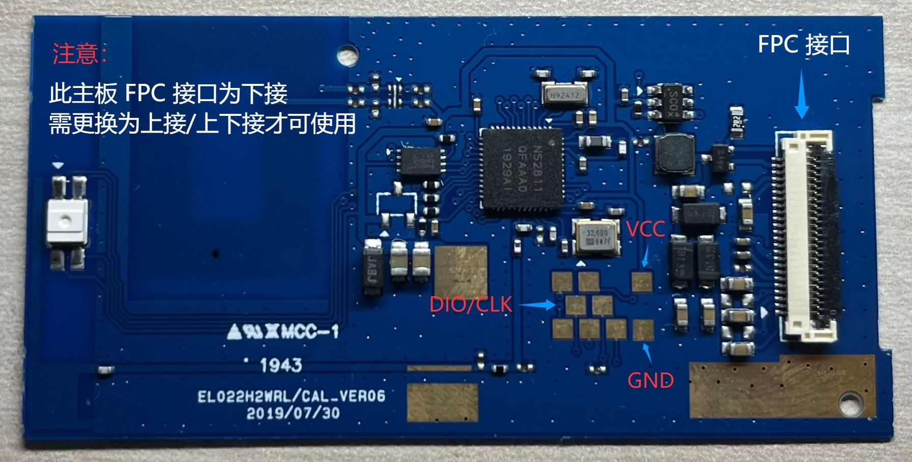

# InkTag nRF52811 Windows Tools

[中文](README.md) | English

For the nRF52811 EL022HWRL board (CAL_VER06). This package contains probe, optional backup, complete-programming tools and portable Python dependencies. Firmware is supplied separately; the tools never download or select firmware automatically. Use complete firmware for programming and OTA firmware for ordinary application updates.

## Preparation

1. Extract the tools, for example to `C:\InkTag\tools\nrf52811_aesl`.
2. Keep complete firmware outside the tools directory, for example at `C:\InkTag\firmware\InkTag-nrf52811_aesl-v0.2.0.0-full.zip`.
3. Install J-Link 7.88j and its USB driver. Connect VTref, GND, SWDIO and SWCLK and power the board. Python, WSL, the Nordic SDK and an Arm compiler are not required. A single connected probe is selected automatically.



Run the following commands from the extracted tools directory.

## Probe and optional backup

Probe without supplying firmware:

```powershell
powershell -NoProfile -ExecutionPolicy Bypass -File tools/probe.ps1 -Chip nrf52811
```

To retain original contents, separately back up internal Flash, FICR and UICR. This backup does not include external image Flash:

```powershell
powershell -NoProfile -ExecutionPolicy Bypass -File tools/backup.ps1 -Chip nrf52811 -Board EL022HWRL
```

## Complete programming

Validate the external complete firmware and configuration without opening a probe:

```powershell
powershell -NoProfile -ExecutionPolicy Bypass -File tools/flash.ps1 -Firmware "C:\InkTag\firmware\InkTag-nrf52811_aesl-v0.2.0.0-full.zip" -Config tools/configs/EL022HWRL.toml -DryRun
```

Program the device:

```powershell
powershell -NoProfile -ExecutionPolicy Bypass -File tools/flash.ps1 -Firmware "C:\InkTag\firmware\InkTag-nrf52811_aesl-v0.2.0.0-full.zip" -Config tools/configs/EL022HWRL.toml
```

Read the clearing scope and enter `y`. Complete programming writes MCU firmware, factory defaults and matching GUI resources, clears ordinary settings, persistent health/crash records, the retained RAM crash mailbox and previous reset/boot-request state, and invalidates old images. Image pixels are not securely erased sector by sector; reserved external Flash areas remain intact. Device identity, BLE address and address type, factory calibration, FICR, UICR and verified boot metadata are preserved. No backup is forced, no clock is synchronized and no Bluetooth provisioning is performed. Final startup occurs only after every independent readback and cleanup check passes. Its new reset reason is not previous reset history.

Use `tools/configs/EL022HWRL.toml` for the original panel, or `tools/configs/EL022HWRL-A0.toml` for A0. For custom wiring, copy a configuration outside the tools directory, edit that copy and pass its path with `-Config`. One precompiled firmware can accept different configurations. Signature, MCU, layout, capacity, App/Recovery pairing and GPIO constraints remain checked. Keep the tools package intact; do not put firmware, edit scripts or write output files inside it.

## Offline checks and updates

```powershell
powershell -NoProfile -ExecutionPolicy Bypass -File tools/check.ps1
```

`tools/setup.ps1` restores the portable environment from bundled pinned archives without network access or system-security changes. SEGGER software and drivers are installed separately and are not redistributed. Tools and firmware have independent versions.

Complete firmware contains matching SoftDevice, Recovery, application and GUI resources. OTA firmware updates the application only, through the [InkTag WebUI](https://solar2ain.github.io/ink-tag/) or shared CLI, not `flash.ps1`. A qualified installed device can gain pin configuration through App OTA while preserving valid preferences. Consult its firmware notes to determine whether Recovery needs a separate update.

The application advertises as `IKT_NRF_XXXX`; Recovery adds `_OTA`. After programming, use the WebUI to synchronize time, select a page and adjust settings.

## Logs and options

Probe/programming logs default to `%TEMP%\InkTag-flashing`; optional backups use `%LOCALAPPDATA%\InkTag\backup-archive`. Custom `-OutputDir` paths must be outside the tools directory. A real SWD probe may halt and resume the CPU and does not infer a PCB model.

Complete programming detects once by default. To wait for wiring, add `-RetryDetect -DetectTimeoutSeconds 120`. This repeats only initial read-only detection before identity is obtained, never capture, erase, programming or verification. Partial reads, wrong identity, uncertain results and subsequent failures stop and retain logs. A 100% progress indication completes one stage; final success requires every readback to pass.

```powershell
powershell -NoProfile -ExecutionPolicy Bypass -File tools/flash.ps1 -Help
```
