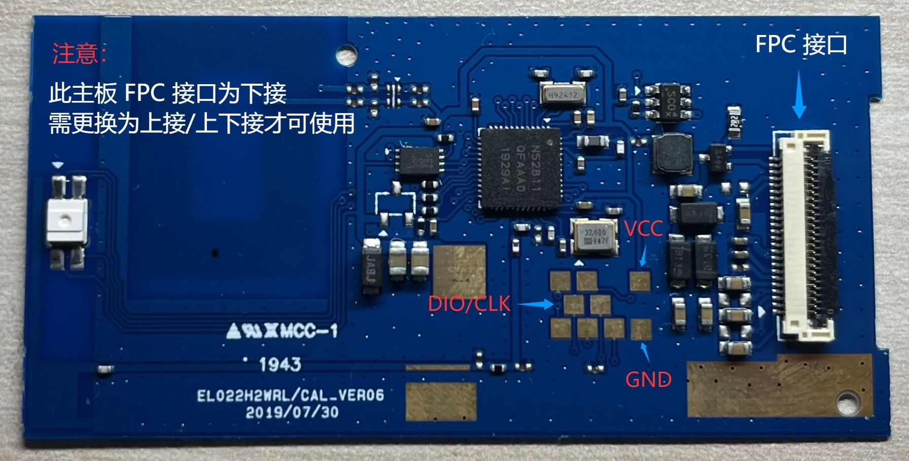

# InkTag nRF52811 Windows 工具

中文 | [English](README.en.md)

适用于 nRF52811 EL022HWRL 主板（CAL_VER06）。工具包提供探测、可选备份、完整烧录和便携 Python 运行环境，不包含固件，不自动下载或选择固件。请另行下载适配的完整固件；日常应用升级使用 OTA 固件。

## 准备

1. 将工具包解压到本地目录，例如 `C:\InkTag\tools\nrf52811_aesl`。
2. 将完整固件放在工具包目录之外，例如 `C:\InkTag\firmware\InkTag-nrf52811_aesl-v0.2.0.0-full.zip`。
3. 安装 J-Link 7.88j 和 USB 驱动，连接 VTref、GND、SWDIO、SWCLK，并为主板供电。无需安装 Python、WSL、Nordic SDK 或 Arm 编译器。只接一只探针时无需指定编号。



以下命令在工具包解压目录运行。

## 探测与备份

探测不需要固件：

```powershell
powershell -NoProfile -ExecutionPolicy Bypass -File tools/probe.ps1 -Chip nrf52811
```

需要保存原厂内容时，可另行备份内部 Flash、FICR 和 UICR；此备份不包含外置图片 Flash：

```powershell
powershell -NoProfile -ExecutionPolicy Bypass -File tools/backup.ps1 -Chip nrf52811 -Board EL022HWRL
```

## 完整烧录

先校验外部完整固件和配置，不访问探针：

```powershell
powershell -NoProfile -ExecutionPolicy Bypass -File tools/flash.ps1 -Firmware "C:\InkTag\firmware\InkTag-nrf52811_aesl-v0.2.0.0-full.zip" -Config tools/configs/EL022HWRL.toml -DryRun
```

执行完整烧录：

```powershell
powershell -NoProfile -ExecutionPolicy Bypass -File tools/flash.ps1 -Firmware "C:\InkTag\firmware\InkTag-nrf52811_aesl-v0.2.0.0-full.zip" -Config tools/configs/EL022HWRL.toml
```

阅读清理范围后输入 `y`。完整烧录写入 MCU 固件、出厂默认配置和配套 GUI 资源，清除普通设置、持久化 health/崩溃记录、保留 RAM 中的旧崩溃邮箱及旧 reset/启动请求状态，并使旧图片失效。图片像素不会逐块安全擦除，外置 Flash 的保留区域保持。芯片身份、BLE 地址及地址类型、出厂校准、FICR、UICR 和已验证的启动元数据保持。工具不强制备份，不自动校时，不通过蓝牙配置设备。只有全部独立回读及清理验证通过后才执行最终启动；这次启动产生的新复位原因不属于旧历史。

原屏使用 `tools/configs/EL022HWRL.toml`；A0 屏使用 `tools/configs/EL022HWRL-A0.toml`。定制接线时，将配置复制到工具包之外修改，并用 `-Config` 指向副本。同一个预编译固件可使用不同配置；工具继续检查签名、主控、布局、容量、App/Recovery 配对和引脚约束。请保持原始工具包完整，不在其中保存固件、修改脚本或写入输出文件。

## 离线检查与更新

```powershell
powershell -NoProfile -ExecutionPolicy Bypass -File tools/check.ps1
```

`tools/setup.ps1` 可从包内锁定依赖恢复便携环境，不联网、不修改系统安全设置。SEGGER 软件和驱动需单独安装，不随包分发。工具版本独立于固件版本。

完整固件包含配套的 SoftDevice、Recovery、应用和 GUI 资源。OTA 固件仅更新应用；通过 [InkTag WebUI](https://solar2ain.github.io/ink-tag/) 或共享 CLI 使用，不交给 `flash.ps1`。已有合格固件可通过 OTA 接入引脚配置，应用保留有效设置；Recovery 是否需要更新由具体固件说明确定。

普通蓝牙名称为 `IKT_NRF_XXXX`，Recovery 名称加 `_OTA`。烧录后可在 WebUI 校时、选择页面和调整设置。

## 日志和参数

探测和烧录日志默认位于 `%TEMP%\InkTag-flashing`，可选备份位于 `%LOCALAPPDATA%\InkTag\backup-archive`。用 `-OutputDir` 自定义位置时，选择工具包目录之外的路径。真实 SWD 探测可能暂停并恢复 CPU，不推断主板型号。

完整烧录默认只检测一次。需要等待接线完成时，可添加 `-RetryDetect -DetectTimeoutSeconds 120`；它只重复最初尚未读出身份的只读探测，不重试捕获、擦写或回读。部分读取、错误身份、未知结果和后续失败都会停止并保留日志。进度100%仅表示当前阶段完成，最终成功以全部回读结果为准。

```powershell
powershell -NoProfile -ExecutionPolicy Bypass -File tools/flash.ps1 -Help
```
